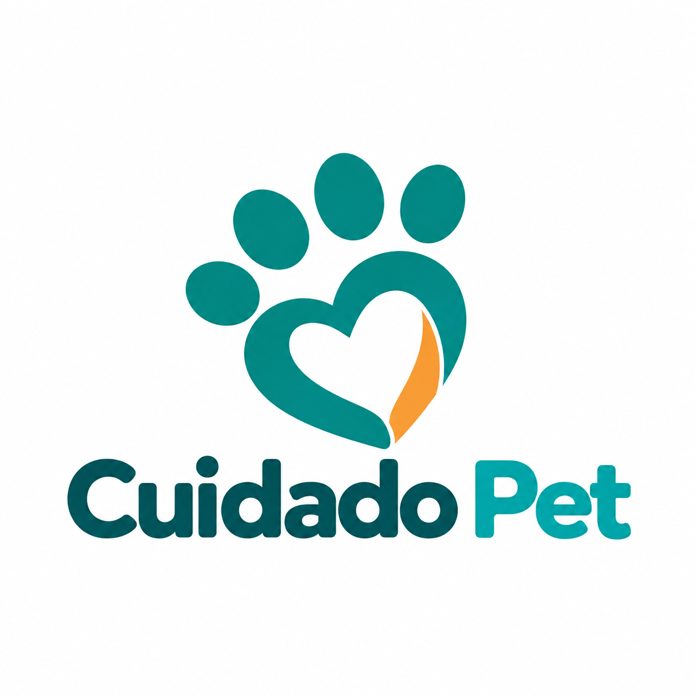

# 🐾 Cuidado Pet — Documentação do Trabalho

---

## 📌 Sumário

1. [Pesquisa tecnológica](#1-pesquisa-tecnológica)
2. [Conceito do produto](#2-conceito-do-produto)
3. [Identidade visual](#3-identidade-visual)
4. [Plano de negócios enxuto](#4-plano-de-negócios-enxuto)
5. [Funcionalidades](#5-funcionalidades)
6. [Protótipo navegável](#6-protótipo-navegável)

---

## ✅ Legenda de status

| Símbolo | Significado |
|---|---|
| ⬜ | Não iniciado |
| 🟨 | Em andamento |
| ✅ | Concluído |
| 🔎 | Precisa de validação/revisão |

---

# 1. Pesquisa tecnológica

## 🎯 Objetivo

Pesquisar tecnologias que possam ser utilizadas no desenvolvimento do **Cuidado Pet**, registrando:

- 10 bibliotecas candidatas;
- 3 frameworks candidatos;
- fonte oficial;
- data da consulta;
- vantagens;
- limitações;
- licença;
- escolha inicial justificada.

---

## 1.1 Frameworks candidatos

| Status | Framework | Uso possível no projeto | Vantagens | Limitações | Licença | Fonte oficial | Data da consulta |
|---|---|---|---|---|---|---|---|
| ⬜ | Next.js | Estruturar a aplicação web com React | Roteamento, renderização e estrutura para aplicações completas | Possui mais conceitos e convenções que React isoladamente | MIT | [https://nextjs.org/](#) | 04/10/26|
| ⬜ | Angular | Construção estruturada da interface web | Framework completo, arquitetura definida e várias ferramentas integradas | Curva de aprendizado maior | MIT | [https://angular.dev/](#) |  04/10/26|
| ⬜ | Vue | Construção progressiva da interface | Flexível, componentizado e relativamente simples de aprender | Ecossistema menor em algumas áreas | MIT | [https://vuejs.org/](#) |  04/10/26 |

### Escolha inicial

**Framework escolhido:** `Next.js`

**Justificativa:**

> O Next.js foi escolhido inicialmente porque permite utilizar React para construir a interface e, ao mesmo tempo, oferece uma estrutura organizada para roteamento, páginas, carregamento de dados e outros recursos necessários para uma aplicação web. Isso reduz a quantidade de configurações manuais e facilita a evolução do Cuidado Pet.
---

## 1.2 Bibliotecas candidatas

| Status | Biblioteca | Uso possível no projeto | Vantagens | Limitações | Licença | Fonte oficial | Data da consulta |
|---|---|---|---|---|---|---|---|
| ⬜ | React | Construção de componentes de interface | Componentização e grande ecossistema | Não define sozinho toda a arquitetura da aplicação | MIT | [https://react.dev/](#) | 04/10/26 |
| ⬜ | React Hook Form | Formulários | Simplifica controle de formulários | Específica para React | MIT | [https://react-hook-form.com/](#) | 04/10/26 |
| ⬜ | Zod | Validação de dados | Regras reutilizáveis e integração com TypeScript | Adiciona outra dependência | MIT | [https://zod.dev/](#) | 04/10/26|
| ⬜ | TanStack Query | Comunicação e sincronização com API | Cache, estados de carregamento e atualização de dados | Pode ser excessiva em projetos muito simples | MIT | [https://tanstack.com/query/latest](#) | 04/10/26|
| ⬜ | Axios | Requisições HTTP | API simples e popular | `fetch` nativo pode atender casos simples | MIT | [https://axios.rest/](#) | 04/10/26 |
| ⬜ | FullCalendar Standard | Agenda e calendário | Facilita visualização de datas, horários e eventos | Recursos Premium têm outra licença | MIT (Standard) | [https://fullcalendar.io/](#) | 04/10/26 |
| ⬜ | date-fns | Datas e horários | Modular e focada em operações com datas | Exige padronização do uso no projeto | MIT | [https://date-fns.org/](#) | 04/10/26|
| ⬜ | Chart.js | Gráficos administrativos | Simples para dashboards | Não é essencial no primeiro MVP | MIT | [https://www.chartjs.org/](#) | 04/10/26|
| ⬜ | Lucide | Ícones | Leve e consistente | Atua somente na parte visual | ISC | [https://lucide.dev/](#) | 04/10/26 |
| ⬜ | Zustand | Estado global | Simples e leve | Pode ser desnecessária se houver pouco estado global | MIT | [https://zustand-demo.pmnd.rs/](#) | 04/10/26|

### Bibliotecas escolhidas inicialmente

- [ ] React
- [ ] React Hook Form
- [ ] Zod
- [ ] TanStack Query
- [ ] Axios
- [ ] FullCalendar
- [ ] date-fns
- [ ] Chart.js
- [ ] Lucide
- [ ] Zustand

# 2. Conceito do produto

## 🐶 Nome do produto

**Cuidado Pet**

## 💬 Frase curta

> **Todo o cuidado do seu pet em um só lugar.**

---

## 2.1 Problema

Pet shops que oferecem diferentes produtos e serviços precisam administrar simultaneamente:

- agenda de banho, tosa e consultas;
- cadastro de clientes e animais;
- vendas e produtos;
- comunicação com os tutores;
- acompanhamento dos atendimentos;
- processos e documentos de adoção.

Quando essas informações ficam separadas ou são controladas manualmente, podem ocorrer:

- conflitos e superlotação de horários;
- atrasos no atendimento;
- dificuldade para avisar o tutor quando o pet está pronto;
- desorganização das informações;
- perda de documentos;
- dificuldade para acompanhar processos de adoção.

---

## 2.2 Público-alvo

### 👤 Cliente / Tutor

Pessoa que deseja:

- cadastrar seus pets;
- agendar serviços;
- comprar produtos;
- acompanhar atendimentos;
- participar de processos de adoção.

### 🧑‍💼 Funcionário / Atendente

Responsável por:

- registrar vendas;
- atualizar produtos;
- organizar agendamentos;
- acompanhar serviços;
- avisar clientes;
- auxiliar nos processos de adoção.

### 🩺 Veterinário / Profissional

Responsável por:

- consultar atendimentos agendados;
- identificar os pets;
- realizar os serviços previstos.

---

## 2.3 Contexto do problema

O sistema será pensado para estabelecimentos do setor pet que oferecem diversos serviços e precisam manter as informações centralizadas.

### Hipóteses que precisam ser validadas

| Hipótese | Como validar | Status |
|---|---|---|
| Pet shops têm dificuldade para controlar horários | Entrevistas com funcionários | ⬜ |
| Clientes gostariam de agendar serviços online | Questionário com tutores | ⬜ |
| Avisar automaticamente quando o pet estiver pronto gera valor | Entrevistas/questionário | ⬜ |
| Centralizar documentos facilita o fluxo de adoção | Conversar com pet shops/ONGs | ⬜ |
| Clientes utilizariam produtos e serviços no mesmo sistema | Questionário | ⬜ |

---

## 2.4 Proposta de valor

> **O Cuidado Pet é uma plataforma digital que centraliza produtos, agendamentos, acompanhamento de serviços e processos de adoção, facilitando a rotina dos funcionários e a experiência dos tutores.**

---

## 2.5 Resultado pretendido

O aplicativo pretende:

- organizar os horários;
- reduzir conflitos de agendamento;
- facilitar a comunicação com clientes;
- centralizar informações do estabelecimento;
- agilizar o atendimento;
- facilitar o controle de produtos e vendas;
- tornar os processos de adoção mais organizados.

---

## 2.6 Diferencial

O principal diferencial proposto é integrar em um mesmo ambiente:

**Loja + Serviços + Acompanhamento do Pet + Adoção**

---

# 3. Identidade visual

## 3.1 Conceito da logo

Ideia inicial:

> Combinar uma **pata de animal** com um **coração**, representando cuidado, proteção e vínculo com os animais.

---

## 3.2 Prompt da logo

```text
Crie uma identidade visual moderna e acolhedora para um aplicativo chamado Cuidado Pet.
O sistema reúne agendamento de banho, tosa e consultas veterinárias, venda de produtos
e adoção de animais. A logo deve combinar de forma minimalista uma pata de animal e
um coração. Utilize verde-azulado como cor principal, azul como cor secundária e
pequenos detalhes em laranja. A identidade deve transmitir cuidado, confiança,
organização e tecnologia, evitando uma aparência excessivamente infantil.
```

---

## 3.3 Versão da logo



---

## 3.4 Paleta de cores

| Uso | Cor | Código |
|---|---|---|
| Principal | Verde-azulado | `#168C8C` |
| Secundária | Azul | `#2563A6` |
| Destaque | Laranja suave | `#F59E5B` |
| Fundo | Branco/cinza muito claro | `#F8FAFC` |
| Texto | Azul escuro | `#172033` |

---

## 3.5 Tipografia

| Uso | Fonte |
|---|---|
| Títulos | **Poppins** |
| Textos e interface | **Inter** |

---

## 3.6 Aplicação da identidade

A identidade deverá ser aplicada em:

- [ ] Logo
- [ ] Tela de login
- [ ] Cabeçalho
- [ ] Botões
- [ ] Cards de serviços
- [ ] Calendário
- [ ] Produtos
- [ ] Área administrativa
- [ ] Protótipo mobile
- [ ] Protótipo desktop

---

## 3.7 Contraste e acessibilidade

- [ ] Verificar contraste entre texto e fundo
- [ ] Verificar contraste dos botões
- [ ] Não utilizar apenas cor para comunicar estados
- [ ] Manter textos legíveis em telas pequenas
- [ ] Conferir tamanhos mínimos de fonte

---

# 4. Plano de negócios enxuto

| Elemento | Definição |
|---|---|
| **Segmentos de clientes** | Pet shops, clínicas veterinárias e estabelecimentos que prestam serviços para animais |
| **Usuários** | Tutores, atendentes, veterinários e administradores |
| **Problema** | Informações e processos espalhados entre agenda, mensagens, vendas e documentos |
| **Proposta de valor** | Centralizar os principais serviços do pet shop em uma única plataforma |
| **Canais** | Aplicação web, redes sociais e divulgação no estabelecimento |
| **Relacionamento** | Autoatendimento digital combinado ao atendimento presencial |
| **Fonte de receita** | Assinatura mensal paga pelo estabelecimento |
| **Custos principais** | Hospedagem, domínio, banco de dados, manutenção, desenvolvimento e integrações |
| **Métrica principal** | Quantidade de agendamentos realizados digitalmente |
| **Outras métricas** | Cancelamentos, conflitos de agenda, usuários ativos, tempo de atendimento e adoções concluídas |
| **Riscos** | Baixa adesão, custos de integrações, proteção de dados e excesso de funcionalidades no MVP |

---

## 4.1 Modelo de sustentabilidade

### Hipótese inicial

Modelo **SaaS**:

> O estabelecimento paga uma assinatura mensal pelo sistema e seus clientes utilizam a plataforma gratuitamente.

### Pontos que ainda precisam ser validados

- [ ] Pet shops pagariam por uma solução desse tipo?
- [ ] Qual seria a faixa de preço aceitável?
- [ ] Quais funcionalidades justificariam a assinatura?
- [ ] Quais custos de infraestrutura precisam ser considerados?
- [ ] Haveria plano gratuito ou período de teste?

---

# 5. Funcionalidades

## 5.1 Perfis do sistema

### 👤 Cliente

- cadastrar seus pets;
- visualizar produtos;
- realizar compras;
- agendar serviços;
- acompanhar atendimentos;
- visualizar animais para adoção;
- solicitar adoção.

### 🧑‍💼 Funcionário

- visualizar serviços;
- finalizar atendimentos;
- atualizar produtos;
- acompanhar solicitações;
- auxiliar no processo de adoção.

### ⚙️ Administrador

- gerenciar usuários;
- gerenciar produtos;
- gerenciar serviços;
- acompanhar informações do sistema.

---

## 5.2 Requisitos funcionais

| ID | Requisito | Prioridade | Status |
|---|---|---|---|
| RF01 | Cadastrar usuário | Deve | ⬜ |
| RF02 | Realizar login | Deve | ⬜ |
| RF03 | Cadastrar pet | Deve | ⬜ |
| RF04 | Visualizar produtos | Deveria | ⬜ |
| RF05 | Adicionar produto ao carrinho | Deveria | ⬜ |
| RF06 | Finalizar compra | Deveria | ⬜ |
| RF07 | Selecionar serviço | Deve | ⬜ |
| RF08 | Selecionar o pet | Deve | ⬜ |
| RF09 | Visualizar datas e horários disponíveis | Deve | ⬜ |
| RF10 | Realizar agendamento | Deve | ⬜ |
| RF11 | Consultar agendamentos | Deve | ⬜ |
| RF12 | Visualizar serviços do dia | Deve | ⬜ |
| RF13 | Finalizar atendimento | Deve | ⬜ |
| RF14 | Avisar o cliente quando o pet estiver pronto | Deve | ⬜ |
| RF15 | Visualizar animais para adoção | Poderia | ⬜ |
| RF16 | Solicitar adoção | Poderia | ⬜ |
| RF17 | Enviar documentação | Poderia | ⬜ |
| RF18 | Avaliar solicitação de adoção | Poderia | ⬜ |

---

## 5.3 Requisitos não funcionais

| ID | Requisito | Status |
|---|---|---|
| RNF01 | A aplicação deverá ser responsiva | ⬜ |
| RNF02 | O sistema deverá utilizar autenticação | ⬜ |
| RNF03 | Os dados enviados deverão ser validados | ⬜ |
| RNF04 | Cada perfil deverá visualizar apenas as funções permitidas | ⬜ |
| RNF05 | A interface deverá possuir contraste adequado | ⬜ |
| RNF06 | O sistema deverá possuir tratamento de erros | ⬜ |
| RNF07 | Os dados pessoais deverão ser protegidos | ⬜ |
| RNF08 | As principais telas deverão possuir boa usabilidade | ⬜ |

---

## 5.4 MVP priorizado

### 🔴 Deve ter

- Login
- Cadastro de pets
- Seleção de serviço
- Seleção do pet
- Calendário
- Escolha de horário
- Confirmação do agendamento
- Visualização dos serviços do dia
- Finalização do atendimento
- Aviso de pet pronto

### 🟡 Deveria ter

- Catálogo de produtos
- Carrinho
- Checkout
- Histórico de serviços
- Confirmação automática

### 🟢 Poderia ter

- Fluxo completo de adoção
- Upload de documentos
- Aprovação/reprovação de adoção
- Dashboard com gráficos
- Recursos administrativos avançados
---

# 6. Protótipo navegável

## 🎯 Objetivo

Construir um protótipo que demonstre como o Cuidado Pet resolve o problema proposto.

---

## 6.1 Fluxo feliz principal

```text
Login
  ↓
Página inicial
  ↓
Serviços
  ↓
Escolher banho, tosa ou consulta
  ↓
Escolher o pet
  ↓
Escolher data
  ↓
Escolher horário disponível
  ↓
Revisar agendamento
  ↓
Confirmar
  ↓
Agendamento realizado
  ↓
Meus agendamentos
  ↓
Em atendimento
  ↓
Pronto para retirada
```

---

## 6.2 Telas principais

| Nº | Tela | Conteúdo | Desktop | Mobile | Status |
|---|---|---|---|---|---|
| 01 | Login | E-mail, senha, cadastro | ⬜ | ⬜ | ⬜ |
| 02 | Home | Serviços, produtos, adoção e atalhos | ⬜ | ⬜ | ⬜ |
| 03 | Meus Pets | Pets cadastrados | ⬜ | ⬜ | ⬜ |
| 04 | Serviços | Banho, tosa e consulta | ⬜ | ⬜ | ⬜ |
| 05 | Agendamento | Calendário e horários | ⬜ | ⬜ | ⬜ |
| 06 | Confirmação | Pet, serviço, data, horário e valor | ⬜ | ⬜ | ⬜ |
| 07 | Meus Agendamentos | Próximos serviços e histórico | ⬜ | ⬜ | ⬜ |
| 08 | Atendimento | Status do serviço | ⬜ | ⬜ | ⬜ |
| 09 | Produtos | Catálogo de produtos | ⬜ | ⬜ | ⬜ |
| 10 | Adoção | Animais disponíveis | ⬜ | ⬜ | ⬜ |

---

## 6.3 Estados da interface

### Estado vazio

Exemplo:

> Você ainda não possui pets cadastrados.

### Estado carregando

Exemplo:

> Exibir `spinner`, `skeleton` ou outro indicador enquanto dados e horários são carregados.

### Estado de erro

Exemplo:

> Não foi possível carregar os horários. Tente novamente.

### Estado de sucesso

Exemplo:

> Agendamento realizado com sucesso.

---


## 6.4 Link do protótipo

**Figma:** `https://www.figma.com/design/xYH8PBnOlPpn6YOKzXcxWI/Cuidado-Pet---Prot%C3%B3tipo?node-id=2-284&t=nHm76seARNlBEtAj-1`

